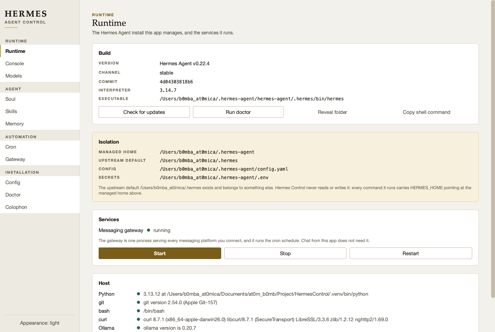
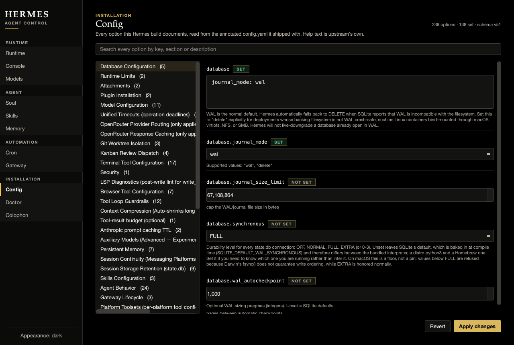

# Hermes Control

A desktop control panel for [Nous Research's Hermes Agent](https://github.com/NousResearch/hermes-agent) — install it, keep it isolated, run it in the background, and reach every setting it documents from one window. Windows, macOS and Linux, one codebase.

Hermes Agent does the thinking. This app is the console in front of it.



---

## Why this exists

Hermes already ships a terminal UI, a web dashboard and an Electron app, so a fourth interface needs a reason. There are three.

**1. Its installer can bury something.** Hermes keeps its whole world in one directory named by `HERMES_HOME`, and the installer defaults that to `~/.hermes` (`%LOCALAPPDATA%\hermes` on Windows). If anything already owns that path, the stock one-liner lands on top of it. Hermes Control always installs to a sibling — `~/.hermes-agent` — and passes `HERMES_HOME` explicitly on **every** command, so a second Hermes on the same machine is never read or written. The Runtime page says so in as many words, because "where did my data go" is the worst question a tool can leave you asking.

**2. "Every setting" is a promise worth keeping literally.** Hermes's configuration runs to roughly 240 options across 42 sections. This app contains no list of them. It derives its schema from the annotated `config.yaml` that *your install shipped with*, so it describes your version of Hermes — including options added after this code was written — with upstream's own prose as the help text.

**3. Local models have a trap in them.** Hermes refuses any model whose context window is under **64,000 tokens**. Ollama serves 32,768 by default, and plenty of popular local models were never trained past 40K. Left alone that produces a turn that dies with a stack trace a minute in. Here it produces a verdict beside the model, before you pick it, with a one-click fix where a fix exists.

---

## What it does

| Page | |
|---|---|
| **Runtime** | Version, channel, commit, interpreter. Isolation, stated explicitly. Gateway start/stop/restart. Host prerequisites. |
| **Console** | Chat, streamed token by token, with a live context-budget ribbon. |
| **Models** | Local servers probed live; ~22 hosted providers with the credential each needs and whether it is set. |
| **Soul** | `SOUL.md` — the agent's identity, first slot in its system prompt. |
| **Skills** | Installed procedures, including ones the agent wrote for itself. |
| **Memory** | The two curated files injected into every session. |
| **Cron** | Scheduled jobs, and whether the gateway is up to run them. |
| **Gateway** | The process serving every messaging channel. |
| **Config** | All ~240 options, searchable, with upstream's help text. |
| **Doctor** | Hermes's own checks, and its logs. |
| **Colophon** | What this is built from, and the decisions worth stating. |

### The ribbon

The meter on the Console is the one thing here no other tool could show, because it is made of Hermes's own mechanic. Hermes does not truncate a long conversation — past `compression.threshold` of the window it rewrites the middle into a summary and continues. The ribbon draws the window, the live token count, the threshold where that happens, and the target it compacts down to. You can see a rewrite coming instead of discovering it afterwards.

---

## Install

Requires Python 3.10+, git and curl (PowerShell on Windows). Hermes's own installer brings its own pinned `uv` and fetches Node itself, so you do **not** need Node, npm or uv on the host.

```bash
git clone https://github.com/at0m-b0mb/HermesControl.git
cd HermesControl
./run.sh          # Windows: .\run.ps1
```

First run creates `.venv`, installs PySide6, and opens the window. If Hermes Agent is not installed yet, the Runtime page says where it will go before anything is written.

---

## Design

Warm paper and ink with a single accent, business-grade rather than neon. There are two golds, not one: a deep brass that stays legible as small text, and a bright shine used only on marks that carry no words. Dark mode is **true black**, with neutral greys above it and nothing in the ramp that reads as blue.

Every colour is declared as a `(light, dark)` pair at the point of definition, so the dark theme cannot be forgotten. A contrast suite checks every text pairing against WCAG AA in both themes — it caught a washed-out grey the eye had passed.

| Role | Face |
|---|---|
| Identity, titles, figures | Iowan Old Style → Palatino → Georgia |
| Anything you operate | SF Pro Text → Helvetica Neue → Segoe UI → Inter |
| Config keys, model names, output | SF Mono → Menlo → Cascadia Mono → DejaVu Sans Mono |

Families are resolved against the live font database at startup, so a painted widget is never silently set in the system default while the rest of the page is not.



---

## How it talks to Hermes

Deliberately mixed, and the choice per operation is about what stays true when Hermes changes underneath:

- **Writes go through the CLI.** `hermes config set` validates, migrates, and decides whether a key belongs in `config.yaml` or `.env`. Re-implementing that judgement by editing YAML would mean re-implementing it badly.
- **Reads come from the files.** Config, cron jobs, skills and the session database are on disk in stable formats. Reading them is faster than spawning a process and survives a reflowed table.
- **Chat goes through `--format stream-json`**, the one surface Hermes documents as machine-readable.

In the version this was built against, `--json` is *rejected* on `status` and `cron`, and `hermes tools` refuses to run without a terminal — which is why the mix is what it is rather than JSON everywhere.

---

## Verified

On macOS 26 (Darwin 27), Python 3.13, PySide6 6.12 / Qt 6.12, against Hermes Agent **v0.22.4**:

- Isolated install into `~/.hermes-agent`, leaving an unrelated `~/.hermes` byte-identical.
- All 11 pages render in both themes with no exceptions (`tools/shoot.py`).
- 88 contrast assertions pass (`pytest tests/`).
- A real local turn end to end: Ollama → `llama3.1` → streamed `PONG`, exit 0, 31s.

Windows and Linux paths are implemented behind `platforms.py` but have **not** been run on those systems yet.

### A note on local model speed

Two of the models tested clear the 64K floor honestly. They are not equivalent:

| Model | Real window | Size | One trivial turn |
|---|---|---|---|
| `llama3.1:latest` | 131,072 | 4.9 GB | **31 s** |
| `huihui_ai/qwen3.5-abliterated:35b` | 262,144 | 23.9 GB | **461 s** |

Both return the right answer. The 35B is the capable one and is a single click away on the Models page; `llama3.1` is the default because a seven-minute round trip is not a usable default.

---

## Licence

MIT. Hermes Agent is MIT-licensed work by Nous Research; this is a separate control panel, not a fork, and adds no model of its own.
