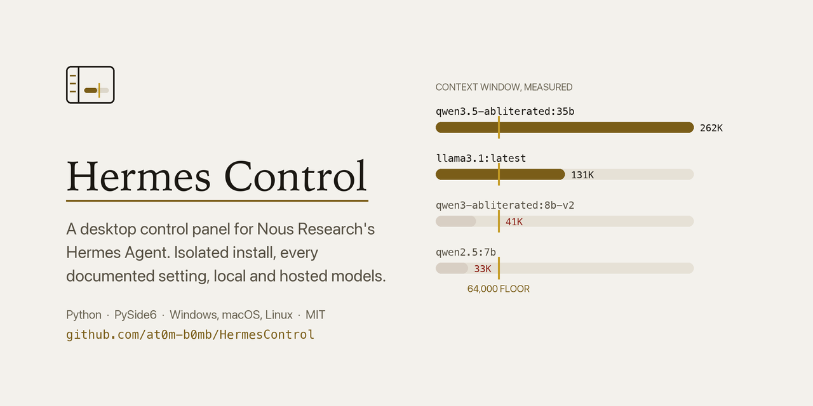

# Hermes Control

A desktop control panel for [Nous Research's Hermes Agent](https://github.com/NousResearch/hermes-agent) — install it, keep it isolated, run it in the background, and reach every setting it documents from one window. Windows, macOS and Linux, one codebase.

Hermes Agent does the thinking. This app is the console in front of it.

**[at0m-b0mb.github.io/HermesControl](https://at0m-b0mb.github.io/HermesControl/)**




---

## Why this exists

Hermes already ships a terminal UI, a web dashboard and an Electron app, so a fourth interface needs a reason. There are three.

**1. Its installer can bury something.** Hermes keeps its whole world in one directory named by `HERMES_HOME`, and the installer defaults that to `~/.hermes` (`%LOCALAPPDATA%\hermes` on Windows). If anything already owns that path, the stock one-liner lands on top of it. Hermes Control always installs to a sibling — `~/.hermes-agent` — and passes `HERMES_HOME` explicitly on **every** command, so a second Hermes on the same machine is never read or written. The Runtime page says so in as many words, because "where did my data go" is the worst question a tool can leave you asking.

**2. "Every setting" is a promise worth keeping literally.** Hermes's configuration runs to roughly 240 options across 42 sections. This app contains no list of them. It derives its schema from the annotated `config.yaml` that *your install shipped with*, so it describes your version of Hermes — including options added after this code was written — with upstream's own prose as the help text.

**3. Local models have two traps in them.** Hermes refuses any model whose context window is under **64,000 tokens** — Ollama serves 32,768 by default, and plenty of popular models were never trained past 40K. Separately, Hermes sends a tool list on *every* request, so a model with no tool-calling support is refused with HTTP 400 before it produces a token: `deepseek-r1` has a 131,072-token window, chats perfectly well, and cannot be an agent. Left alone, either one produces a turn that dies a minute in for a reason nothing surfaces. Here they produce a verdict beside the model, before you pick it, naming which requirement failed.

---

## What it does

| Page | |
|---|---|
| **Setup** | Four steps from nothing to a working agent: host check, install Hermes, get a model, done. |
| **Runtime** | Version, channel, commit, interpreter. Isolation, stated explicitly. Gateway start/stop/restart. Host prerequisites. |
| **Console** | Chat, streamed token by token, with a live context-budget ribbon. |
| **Models** | Local servers probed live; a model library with one-click download and removal; ~22 hosted providers with the credential each needs. |
| **Soul** | `SOUL.md` — the agent's identity, first slot in its system prompt. |
| **Skills** | Installed procedures, including ones the agent wrote for itself. |
| **Memory** | The two curated files injected into every session. |
| **Cron** | Scheduled jobs, and whether the gateway is up to run them. |
| **Gateway** | The process serving every messaging channel, and a full email setup form with a staged connection test. |
| **Connectors** | The ~54 apps Hermes can act on, and the one Nous Portal sign-in they all depend on. |
| **Config** | All ~240 options, searchable, with upstream's help text. |
| **Doctor** | Hermes's own checks, and its logs. |
| **Colophon** | What this is built from, and the decisions worth stating. |

### The ribbon

The meter on the Console is the one thing here no other tool could show, because it is made of Hermes's own mechanic. Hermes does not truncate a long conversation — past `compression.threshold` of the window it rewrites the middle into a summary and continues. The ribbon draws the window, the live token count, the threshold where that happens, and the target it compacts down to. You can see a rewrite coming instead of discovering it afterwards.

---

## Which models can actually be agents

Two of Hermes's requirements are checkable — a 64,000-token window and tool-calling support, both of which Ollama reports. The third is not: whether the model can *use* tools competently. Several popular models pass both checks, answer ordinary chat perfectly, and still cannot complete a two-step job.

```bash
python3 tools/model_bench.py            # every installed model
python3 tools/model_bench.py hermes3    # or just some
```

Each model gets the same task in a throwaway directory — read a file, write it back with a line added — and is scored on whether the file actually changed. Two steps rather than one on purpose: a single write can be luck, while read-then-write needs the model to carry a result from one call into the next, which is where the weak ones fall over.

---

## Getting a model

Hermes needs a model, and most of the obvious choices don't qualify — its 64,000-token floor rules out `qwen2.5`, `phi4`, `mistral:7b` and plenty of others. So the Models page has a short library of models chosen for exactly one reason: each clears the floor.

Downloads stream real progress from Ollama, layer by layer. Ollama reports bytes **per layer** rather than for the whole download, so the bar tracks the layer in flight and the caption counts layers — a single percentage computed from those numbers jumps backwards every time a layer completes.

You can also pull anything the registry accepts by name, including a Hugging Face GGUF:

```
llama3.3:70b
hf.co/user/repo:Q4_K_M
```

The published context window gets a model onto your disk; the **measured** one decides whether it can be used. After every download the app re-reads the real window from the model itself and tells you if it fell short — because a wrong published figure is precisely the trap this is here to prevent.

> Ollama publishes no search or library API (`/api/library` and `/api/search` both 404), so this is a curated list plus a name field, not a browsable catalogue. Pretending otherwise would mean screen-scraping something that would rot.

---

## Connectors and email

**Connectors** are the third-party apps Hermes can act on — Linear, Notion, Slack, Stripe and ~50 more. Every one of them is brokered by **Nous Portal**, so none work until that account is signed in. The connector listing never says this; each row just reads `not connected`, which looks like fifty separate problems rather than one missing sign-in. The Connectors page leads with exactly that.

Signing in, and connecting each app, are browser flows against your own accounts with your own passwords and second factors. The app opens them and reports the outcome — it does not handle those credentials.

**Email** is a first-class gateway platform: Hermes polls an IMAP mailbox and replies over SMTP, so anyone you allow can simply write to the agent. The Gateway page has the full form, with host settings filled in from your address, and everything stored in `.env` rather than `config.yaml` because the keys are `UPPER_SNAKE`.

Two things that form knows, which save a long detour:

- **Gmail, Outlook, iCloud and Yahoo all refuse ordinary passwords.** You need an app password, and the error they return for the account password is an unhelpful generic failure. The form says so before the attempt.
- **"It doesn't work" has several very different causes** — DNS, a blocked port, TLS, a wrong password, IMAP disabled on the account. The connection test runs in stages and reports the first one that failed, by name, instead of one flat refusal.

---

## Install

Requires Python 3.10+, git and curl (PowerShell on Windows). Hermes's own installer brings its own pinned `uv` and fetches Node itself, so you do **not** need Node, npm or uv on the host.

```bash
git clone https://github.com/at0m-b0mb/HermesControl.git
cd HermesControl
./run.sh          # Windows: .\run.ps1
```

First run creates `.venv`, installs PySide6, and opens the window. If Hermes Agent is not installed yet, the Runtime page says where it will go before anything is written.

---

## Design

Warm paper and ink with a single accent, business-grade rather than neon. There are two golds, not one: a deep brass that stays legible as small text, and a bright shine used only on marks that carry no words. Dark mode is **true black**, with neutral greys above it and nothing in the ramp that reads as blue.

Every colour is declared as a `(light, dark)` pair at the point of definition, so the dark theme cannot be forgotten. A contrast suite checks every text pairing against WCAG AA in both themes — it caught a washed-out grey the eye had passed.

| Role | Face |
|---|---|
| Identity, titles, figures | Iowan Old Style → Palatino → Georgia |
| Anything you operate | SF Pro Text → Helvetica Neue → Segoe UI → Inter |
| Config keys, model names, output | SF Mono → Menlo → Cascadia Mono → DejaVu Sans Mono |

Families are resolved against the live font database at startup, so a painted widget is never silently set in the system default while the rest of the page is not.


---

## Where the agent works

`hermes chat` does not necessarily run the turn in the process you started. When a gateway is running — which it is by default — the turn is handed to *that* process, whose working directory is the Hermes checkout. So an agent told to write `notes.txt` wrote it inside the installation, and a `cwd` passed to the subprocess did nothing at all.

The Console therefore shows a working directory and scopes every turn to it with `--in`. Where a file lands should never be a guess.

---

## How it talks to Hermes

Deliberately mixed, and the choice per operation is about what stays true when Hermes changes underneath:

- **Writes go through the CLI.** `hermes config set` validates, migrates, and decides whether a key belongs in `config.yaml` or `.env`. Re-implementing that judgement by editing YAML would mean re-implementing it badly.
- **Reads come from the files.** Config, cron jobs, skills and the session database are on disk in stable formats. Reading them is faster than spawning a process and survives a reflowed table.
- **Chat goes through `--format stream-json`**, the one surface Hermes documents as machine-readable.

In the version this was built against, `--json` is *rejected* on `status` and `cron`, and `hermes tools` refuses to run without a terminal — which is why the mix is what it is rather than JSON everywhere.

---

## Verified

On macOS 26 (Darwin 27), Python 3.13, PySide6 6.12 / Qt 6.12, against Hermes Agent **v0.22.4**:

- Isolated install into `~/.hermes-agent`, leaving an unrelated `~/.hermes` byte-identical by SHA-256.
- All 11 pages render in both themes with no exceptions (`tools/shoot.py`).
- **226 tests pass**, including a functional suite that drives the real widgets, platform-simulation tests for the Windows and Linux branches, and a first-run suite that drives the app against an empty install.
- A chat turn end to end *through the interface*: typed into the Console, streamed back, answer in the transcript, token accounting delivered to the ribbon.
- Editing a setting and pressing Apply is asserted to reach `config.yaml`, and the original is restored.
- Every local model's verdict is checked against what Ollama actually reports, and a model under the floor is asserted to be unselectable.
- **Conversation continuity is asserted mechanically**: a resumed turn reuses the same session, opens no new one, and shows a larger input-token count because the earlier turn is now in the prompt.
- **Exceptions inside Qt callbacks fail the test.** They do not reach the caller — Qt hands them to `sys.excepthook` and carries on with a half-drawn page — so without this a broken page renders and passes.

```bash
./.venv/bin/python -m pytest tests/ -q      # all of it, ~35s plus one real turn
HC_SKIP_SLOW=1 ./.venv/bin/python -m pytest tests/ -q   # skip the live model turn
./.venv/bin/python tools/shoot.py           # render every page in both themes
```

The three suites answer different questions. `test_theme.py` asks whether it can be read, `test_confschema.py` whether the schema parser loses or invents settings, and `test_functional.py` whether pressing the buttons does anything.

Windows and Linux paths are implemented behind `platforms.py` but have **not** been run on those systems yet.

### A note on local model speed

Two of the models tested clear the 64K floor honestly. They are not equivalent:

| Model | Real window | Size | One trivial turn |
|---|---|---|---|
| `llama3.1:latest` | 131,072 | 4.9 GB | **31 s** |
| `huihui_ai/qwen3.5-abliterated:35b` | 262,144 | 23.9 GB | **461 s** |

Both return the right answer. The 35B is the capable one and is a single click away on the Models page; `llama3.1` is the default because a seven-minute round trip is not a usable default.

---

## Licence

MIT. Hermes Agent is MIT-licensed work by Nous Research; this is a separate control panel, not a fork, and adds no model of its own.
