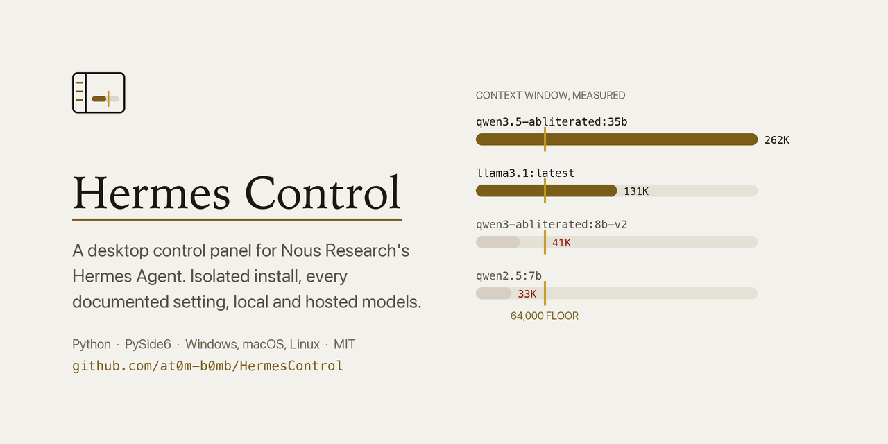
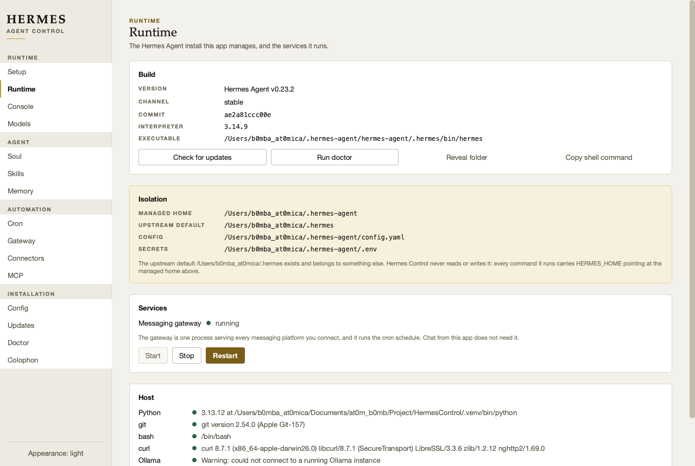
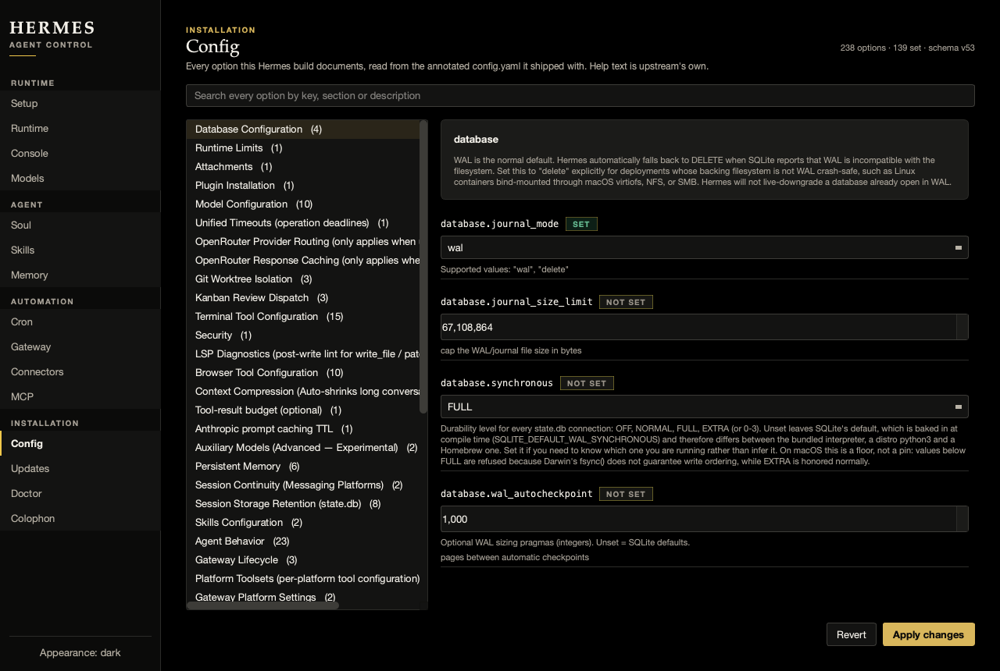

# Hermes Control

A desktop control panel for [Nous Research's Hermes Agent](https://github.com/NousResearch/hermes-agent) — install it, keep it isolated, run it in the background, and reach every setting it documents from one window. Windows, macOS and Linux, one codebase.

Hermes Agent does the thinking. This app is the console in front of it.

**[at0m-b0mb.github.io/HermesControl](https://at0m-b0mb.github.io/HermesControl/)**





---

## Why this exists

Hermes already ships a terminal UI, a web dashboard and an Electron app, so a fourth interface needs a reason. There are three.

**1. Its installer can bury something.** Hermes keeps its whole world in one directory named by `HERMES_HOME`, and the installer defaults that to `~/.hermes` (`%LOCALAPPDATA%\hermes` on Windows). If anything already owns that path, the stock one-liner lands on top of it. Hermes Control always installs to a sibling — `~/.hermes-agent` — and passes `HERMES_HOME` explicitly on **every** command, so a second Hermes on the same machine is never read or written. The Runtime page says so in as many words, because "where did my data go" is the worst question a tool can leave you asking.

**2. "Every setting" is a promise worth keeping literally.** Hermes's configuration runs to roughly 240 options across 42 sections. This app contains no list of them. It derives its schema from the annotated `config.yaml` that *your install shipped with*, so it describes your version of Hermes — including options added after this code was written — with upstream's own prose as the help text.

**3. Local models have three traps in them.** Hermes refuses any model whose context window is under **64,000 tokens** — Ollama serves 32,768 by default, and plenty of popular models were never trained past 40K. Separately, Hermes sends a tool list on *every* request, so a model with no tool-calling support is refused with HTTP 400 before it produces a token: `deepseek-r1` has a 131,072-token window, chats perfectly well, and cannot be an agent. And LM Studio serves a model at the context length chosen when it was *loaded*, which defaults far below what the model supports — the server reports it as healthy, Hermes refuses every turn, and neither interface connects the two. Left alone, each produces a turn that dies a minute in for a reason nothing surfaces. Here they produce a verdict beside the model, before you pick it, naming which requirement failed — and for the LM Studio case, a button that reloads the model at a window that works.

---

## What it does

| Page | |
|---|---|
| **Setup** | Four steps from nothing to a working agent: host check, install Hermes, get a model, done. |
| **Runtime** | Version, channel, commit, interpreter. Isolation, stated explicitly. Gateway start/stop/restart. Host prerequisites. |
| **Console** | Chat, streamed token by token. Opens with a briefing of every tool the model is actually being handed; each call shows its arguments, timing and result. Live context-budget ribbon. |
| **Models** | Local servers probed live — the window a model is *served* at, not the one it advertises, plus tool and vision support as the server reports them; a model library with one-click download; ~22 hosted providers. |
| **Soul** | `SOUL.md` — the agent's identity, first slot in its system prompt. |
| **Skills** | Installed procedures and whether each can actually run; a search across every registry Hermes knows; the three routes to your own mailbox. |
| **Memory** | The two curated files injected into every session. |
| **Cron** | Scheduled jobs, and whether the gateway is up to run them. |
| **Gateway** | The process serving every channel, each judged by asking the gateway what it can reach; a test message to prove one; a full email setup form with a staged connection test. |
| **Connectors** | The ~54 apps Hermes can act on, and the one Nous Portal sign-in they all depend on. |
| **MCP** | The Nous-approved MCP catalogue, plus adding any server beyond it by URL or command. |
| **Config** | All ~240 options, searchable, with upstream's help text. |
| **Updates** | Hermes Agent, hub skills and this app, each checked against its own source and named for what it is a version *of*. |
| **Doctor** | Hermes's own checks, and its logs. |
| **Colophon** | What this is built from, and the decisions worth stating. |

### Three themes

Light and true-black are the house pair. The third is **Hermes** — the official dashboard's own palette (`#041C1C` ground, `#FFE6CB` ink), read from its CSS custom properties rather than sampled from a screenshot. It is a recolouring of the dark theme rather than a third palette to maintain: a token declares a Hermes value only where the official one genuinely differs, so nothing can be silently forgotten. All three are held to the same WCAG AA contrast floors by the same test.

### The briefing

The Console opens on the question everyone actually has — *can it really touch my files?* — answered from the tool schemas Hermes reports it is sending, not from what this app hopes is enabled:

```
19 TOOLS IN 11 SETS
file ×4      read, write, patch and search files
terminal ×1  run shell commands
vision ×1    look at images
…
```

It also states the room left for conversation after the system prompt and tool schemas, because on a 65,536-token window those are most of it.

### The ribbon

The meter on the Console is the one thing here no other tool could show, because it is made of Hermes's own mechanic. Hermes does not truncate a long conversation — past `compression.threshold` of the window it rewrites the middle into a summary and continues. The ribbon draws the window, the live token count, the threshold where that happens, and the target it compacts down to. You can see a rewrite coming instead of discovering it afterwards.

---

## Which models can actually be agents

Two of Hermes's requirements are checkable from what the server reports — a 64,000-token window and tool-calling support. The third is not: whether the model can *use* tools competently. Several popular models pass both checks, answer ordinary chat perfectly, and still cannot complete a two-step job.

```bash
python3 tools/model_bench.py            # every model, both servers
python3 tools/tool_check.py             # does it use its tools, really
```

`tool_check.py` asks the harder question and scores every check on an **effect**, never on what the model said. A model that replies "I have created the file" and creates nothing fails — that answer is indistinguishable from success in a transcript, and is the commonest way a weak local model looks like it is working.

```
check      result      time  tools called
write      PASS       12.0s  write_file
read       PASS       10.7s  read_file
edit       PASS       17.2s  read_file, write_file
search     PASS       16.5s  search_files, write_file
shell      PASS       27.7s  terminal, read_file
5 of 5 checks passed.
```

Each model gets the same task in a throwaway directory — read a file, write it back with a line added — and is scored on whether the file actually changed. Two steps rather than one on purpose: a single write can be luck, while read-then-write needs the model to carry a result from one call into the next, which is where the weak ones fall over.

Measured here:

| Model | Server | Window | Tools | Images | Result |
|---|---|---|---|---|---|
| `google/gemma-4-e4b` | LM Studio | 65,536 | yes | yes | **completed it, 13 s** |
| seven models, 1B–30B | Ollama | ≥64K | yes | — | none completed it |

The seven include Nous's own `hermes3` and `mistral-small` at 24B. They acknowledge Hermes's correction when a call is malformed and then do not act on it. So the serving stack turns out to matter as much as the model, and a result does not transfer between servers — which is the argument for benchmarking rather than reasoning about it.

---

## Getting a model

Hermes needs a model, and most of the obvious choices don't qualify — its 64,000-token floor rules out `qwen2.5`, `phi4`, `mistral:7b` and plenty of others. So the Models page has a short library of models chosen for exactly one reason: each clears the floor.

Downloads stream real progress from Ollama, layer by layer. Ollama reports bytes **per layer** rather than for the whole download, so the bar tracks the layer in flight and the caption counts layers — a single percentage computed from those numbers jumps backwards every time a layer completes.

You can also pull anything the registry accepts by name, including a Hugging Face GGUF:

```
llama3.3:70b
hf.co/user/repo:Q4_K_M
```

The published context window gets a model onto your disk; the **measured** one decides whether it can be used. After every download the app re-reads the real window from the model itself and tells you if it fell short — because a wrong published figure is precisely the trap this is here to prevent.

> Ollama publishes no search or library API (`/api/library` and `/api/search` both 404), so this is a curated list plus a name field, not a browsable catalogue. Pretending otherwise would mean screen-scraping something that would rot.

---

## Five extension surfaces, and where email actually is

This trips everyone up, so both the Skills and MCP pages lead with it. People look for email under Connectors, don't find it, and reasonably conclude Hermes cannot touch a mailbox.

| What you want | Where it actually lives |
|---|---|
| **People emailing the agent** | Hermes's own **IMAP/SMTP gateway platform** — the Gateway page |
| **The agent reading and sending from your mailbox** | A **skill** — the Skills page. Not a connector, not an MCP server |
| Messaging | Gateway platforms: Telegram, Discord, Slack, WhatsApp, Teams, Google Chat |
| App accounts | Portal connectors — ~54, all gated behind one Nous Portal sign-in |
| New tools | **MCP servers** — a Nous-approved catalogue, plus `add` for anything beyond it |
| Procedures | **Skills** — 58 ship with an install, and `skills search` reaches thousands more |

The two email rows are different directions and are constantly mistaken for each other. The gateway adapter is **inbound**: someone writes to the agent's mailbox and it replies. It gives the agent no ability to read your mail. For that you install a skill, and the Skills page names three routes with what each actually needs — `himalaya` for any provider, Gmail's own API, or Microsoft Graph.

**An earlier version of this README said email was on none of the obvious surfaces, having checked the connector list and the MCP catalogue and found nothing.** That was wrong, because it was the wrong two lists. `hermes skills search email` returns twenty-five results, and `himalaya` is already installed by default — it simply cannot run until its binary is on the machine, which nothing told you.

### The gap that produces

A skill with an unmet prerequisite installs cleanly, appears in every listing, and fails the first time the agent reaches for it. On this machine eight of the fifty-eight were in that state, `himalaya` among them. The Skills page checks each skill's declared commands against the host and marks the ones that cannot run, because "installed" and "usable" are not the same claim.

## Long conversations, and the window nobody agrees on

Hermes does not truncate a long conversation — past `compression.threshold` of the window it rewrites the middle into a summary and continues, which is what makes a conversation able to run indefinitely.

That only works if everyone agrees what the window *is*, and here they did not. Hermes sizes its compressor from `model.ollama_num_ctx` **whatever the provider** — the log line says "Ollama num_ctx" while talking to LM Studio. Left at a previous model's value it believed 131,072 against a server serving 65,536, so compaction was scheduled past the point the server can accept, and a long conversation grew until it was silently truncated. Nothing reported that. The thread simply started going missing, which reads as the model forgetting rather than as a misconfiguration.

Selecting an LM Studio model now writes the served window alongside it, and a disagreement between the two is reported beside the model with the exact key to fix.

## Connectors, channels and email

**Hosted providers are judged by Hermes's own credential pool**, not by what sits in `.env`. The previous version decided readiness like this:

```python
have = provider.credential in secrets if provider.credential else provider.oauth
```

For a key-based provider that works. For an **OAuth** one the credential name is empty, so the expression collapses to `provider.oauth` — a constant, `True` by definition. Every OAuth provider therefore showed a live badge and an enabled **Use** button whether or not anyone had ever signed in, and offered no way to sign in at all. `hermes auth list` is the real answer, and the rows now carry a sign-in that streams the device code as it arrives.

**Connectors** are the third-party apps Hermes can act on — Linear, Notion, Slack, Stripe and ~50 more. Every one is brokered by **Nous Portal**, so none work until that account is signed in. The connector listing never says this; each row just reads `not connected`, which looks like fifty separate problems rather than one missing sign-in. The Connectors page leads with exactly that.

**Channels are judged by asking the gateway, not by reading `.env`.** A token being present proves nothing, and the three states that matter look alike from outside:

- **Configured** — the credentials are in `.env`. Easiest to check, least informative: a token can be present and wrong.
- **Allowed** — someone is on that channel's allowlist. Hermes denies by default, so a correctly configured channel with an empty allowlist connects, receives your message, and ignores it in silence. This is the most confusing failure here, because every visible sign says it is working.
- **Deliverable** — `hermes send --list` reports it as a target. This is the only one that is evidence, because it uses the credentials the gateway really loaded.

The Gateway page shows all three per channel and offers a **test message**, which goes through the gateway's own delivery path with no model and no agent loop in the way — so a message that arrives proves the channel and nothing else is being tested alongside it.

**Email as an inbound channel** is a first-class gateway platform: Hermes polls an IMAP mailbox and replies over SMTP. Two things that form knows, which save a long detour:

- **Gmail, Outlook, iCloud and Yahoo all refuse ordinary passwords.** You need an app password, and the error they return for the account password is an unhelpful generic failure. The form says so before the attempt.
- **"It doesn't work" has several very different causes** — DNS, a blocked port, TLS, a wrong password, IMAP disabled on the account. The connection test runs in stages and reports the first one that failed, by name, instead of one flat refusal.

## Install

Requires Python 3.10+, git and curl (PowerShell on Windows). Hermes's own installer brings its own pinned `uv` and fetches Node itself, so you do **not** need Node, npm or uv on the host.

```bash
git clone https://github.com/at0m-b0mb/HermesControl.git
cd HermesControl
./run.sh          # Windows: .\run.ps1
```

First run creates `.venv`, installs PySide6, and opens the window. If Hermes Agent is not installed yet, the Runtime page says where it will go before anything is written.

---

## Design

Warm paper and ink with a single accent, business-grade rather than neon. There are two golds, not one: a deep brass that stays legible as small text, and a bright shine used only on marks that carry no words. Dark mode is **true black**, with neutral greys above it and nothing in the ramp that reads as blue.

Every colour is declared as a `(light, dark)` pair at the point of definition, so the dark theme cannot be forgotten. A contrast suite checks every text pairing against WCAG AA in both themes — it caught a washed-out grey the eye had passed.

| Role | Face |
|---|---|
| Identity, titles, figures | Iowan Old Style → Palatino → Georgia |
| Anything you operate | SF Pro Text → Helvetica Neue → Segoe UI → Inter |
| Config keys, model names, output | SF Mono → Menlo → Cascadia Mono → DejaVu Sans Mono |

Families are resolved against the live font database at startup, so a painted widget is never silently set in the system default while the rest of the page is not.



---

## Where the agent works

`hermes chat` does not necessarily run the turn in the process you started. When a gateway is running — which it is by default — the turn is handed to *that* process, whose working directory is the Hermes checkout. So an agent told to write `notes.txt` wrote it inside the installation, and a `cwd` passed to the subprocess did nothing at all.

The Console therefore shows a working directory and scopes every turn to it with `--in`. Where a file lands should never be a guess.

---

## How it talks to Hermes

Deliberately mixed, and the choice per operation is about what stays true when Hermes changes underneath:

- **Writes go through the CLI.** `hermes config set` validates, migrates, and decides whether a key belongs in `config.yaml` or `.env`. Re-implementing that judgement by editing YAML would mean re-implementing it badly.
- **Reads come from the files.** Config, cron jobs, skills and the session database are on disk in stable formats. Reading them is faster than spawning a process and survives a reflowed table.
- **Chat goes through `--format stream-json`**, the one surface Hermes documents as machine-readable.

In the version this was built against, `--json` is *rejected* on `status` and `cron`, and `hermes tools` refuses to run without a terminal — which is why the mix is what it is rather than JSON everywhere.

---

## Verified

On macOS 26 (Darwin 27), Python 3.13, PySide6 6.12 / Qt 6.12, against Hermes Agent **v0.22.4**:

- Isolated install into `~/.hermes-agent`, leaving an unrelated `~/.hermes` byte-identical by SHA-256.
- All 11 pages render in both themes with no exceptions (`tools/shoot.py`).
- **323 tests pass**, including a functional suite that drives the real widgets, platform-simulation tests for the Windows and Linux branches, and a first-run suite that drives the app against an empty install.
- A chat turn end to end *through the interface*: typed into the Console, streamed back, answer in the transcript, token accounting delivered to the ribbon.
- Editing a setting and pressing Apply is asserted to reach `config.yaml`, and the original is restored.
- Every local model's verdict is checked against what Ollama actually reports, and a model under the floor is asserted to be unselectable.
- **Conversation continuity is asserted mechanically**: a resumed turn reuses the same session, opens no new one, and shows a larger input-token count because the earlier turn is now in the prompt.
- **Exceptions inside Qt callbacks fail the test.** They do not reach the caller — Qt hands them to `sys.excepthook` and carries on with a half-drawn page — so without this a broken page renders and passes.
- **A local model completing real agentic work**, through LM Studio: read a file, write it back changed, and separately describe an image correctly.
- **The skill count is asserted against the files on disk**, which is how the two-level tree was caught: the page had been reporting twelve category folders as skills and losing all fifty-eight real ones.
- Every channel's verdict is asserted to come from the gateway's own target listing, and the three states that look alike from outside — configured, allowed, deliverable — are asserted to be reported separately.

```bash
./.venv/bin/python -m pytest tests/ -q      # all of it, ~35s plus one real turn
HC_SKIP_SLOW=1 ./.venv/bin/python -m pytest tests/ -q   # skip the live model turn
./.venv/bin/python tools/shoot.py           # render every page in both themes
```

The three suites answer different questions. `test_theme.py` asks whether it can be read, `test_confschema.py` whether the schema parser loses or invents settings, and `test_functional.py` whether pressing the buttons does anything.

Windows and Linux paths are implemented behind `platforms.py` but have **not** been run on those systems yet.

### A note on local model speed

Clearing the floor honestly does not make two models equivalent:

| Model | Server | Served window | Size | One trivial turn |
|---|---|---|---|---|
| `google/gemma-4-e4b` | LM Studio | 65,536 | 6.9 GB | **7 s** |
| `llama3.1:latest` | Ollama | 131,072 | 4.9 GB | 31 s |
| `huihui_ai/qwen3.5-abliterated:35b` | Ollama | 262,144 | 23.9 GB | 461 s |

All three return the right answer to a trivial question. Only the first completed the two-step job, which is the distinction that matters and the one speed does not predict.

---

## Licence

MIT. Hermes Agent is MIT-licensed work by Nous Research; this is a separate control panel, not a fork, and adds no model of its own.
